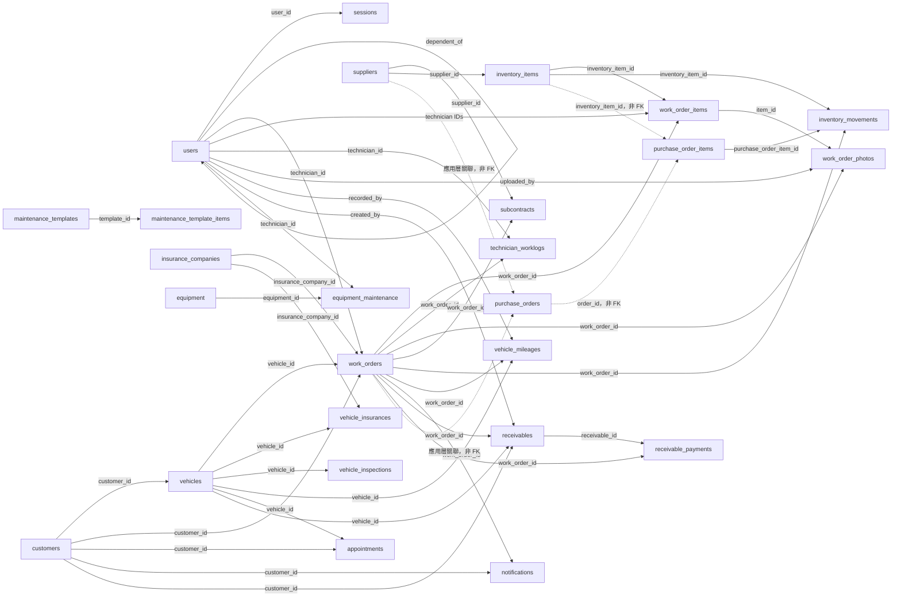

# AutoRepair OS – 汽車修護廠區域網路管理系統 需求規格書 (SRS)

> 版本：1.1 | 日期：2026-10-16

## 1. 專案簡介 (Introduction)

### 1.1 專案名稱

AutoRepair OS – 汽車修護廠區域網路管理系統。

### 1.2 專案目標

為中小型汽修廠提供一套「離線優先、單機/區網部署、高效且容易維護」的管理系統。除了涵蓋開單、派工、庫存、帳務、保險等傳統營運閉環，更導入：

- **現場技師友善體驗：** 解決黑手打字不便、條碼尋料、SOP 清單與車身舊傷免責等現場痛點。
- **透明化車主體驗：** LINE 估價授權、施工照片標記與對比、數位履歷與即時進度通知。
- **老闆與會計友善的營運分析：** 工單毛利、服務線別表現、技師效率、顧客留存率、AR/AP Aging 與匯出介面。

### 1.3 主要使用者

- 修車廠老闆 (Owner)
- 櫃檯人員 (Counter)
- 現場技師 (Technician)
- 車主 (Customer, 透過 LINE / Web 互動)
- 系統維運人員 / 顧問 (System Admin)

## 2. 範疇與角色 (Scope & User Roles)

### 2.1 系統範疇 (Scope)

**In scope：**

- 客戶管理 (CRM) 與車輛履歷： 車身舊傷預檢圖、LINE 數位保養 Passbook。
- 零件供應商與庫存管理： 料位儲位管理、安全庫存警示與死頭料分析。
- 維修工單與現場施工： 多技師派工、SOP 檢查表、語音/片語輸入、施工照片/舊品標記上傳。
- 帳務收付款與財務分析： AR/AP Aging 管理、毛利與營運報表、會計系統資料匯出。
- 預約與工位排程： 工位調度、預約提醒與進場前導通知。
- 自動化關懷與線上互動： LINE／Telegram 自動推播（驗車／保養／完工通知）、LINE 電子估價單一鍵授權。
- 列印與匯出表單： 估價單、工單、發票/收據、AR 催款單、AP 對帳單、日結報表與營運分析報表。

**Out of scope：**

- 會計總帳、稅務申報（由外部會計系統處理）。
- 多店雲端整合（以單店、單 SQLite DB 為前提）。
- 人力資源與薪資系統（僅提供技師工時與抽成參考）。

### 2.2 使用者角色 (User Classes)

- **老闆 (owner)：** 關注營收、毛利、技師績效、顧客留存、重大設備維護與營運分析報表。
- **櫃檯 (counter)：** 負責接待預檢、預約排程、開估價單/工單、LINE 電子估價授權、結帳收款、簡易庫存操作與列印表單。
- **技師 (technician)：** 查看派工工單、語音/片語回報進度、圈選拍照上傳故障/舊品對比圖、執行 SOP 檢查表與填寫實際工時。
- **車主 / 客戶 (customer)：** 接收 LINE 施工進度推播、線上審核/授權估價單、查看愛車數位維修履歷與保養診斷書。
- **系統維運者 / 顧問：** 負責 Docker 部署、自動備份、版本升級與環境設定，管理帳號與權限。

## 3. 技術堆疊與運行環境 (Tech Stack & Environment)

- **後端：** Go 1.22+（net/http 相容），採 internal 分層：config / db / model / handler / service / cron / integration。
- **前端：** Templ 型別安全 HTML 元件 + HTMX 無刷新互動；Tailwind CSS 為主要樣式；整合 Web Speech API（語音輸入）與 Canvas（照片劃線標記）。
- **資料庫：** SQLite（WAL 模式），單一檔案 autorepair.db，連線字串：`file:autorepair.db?_journal_mode=WAL&_busy_timeout=5000`，Go 端設定 `db.SetMaxOpenConns(1)`。
- **靜態檔案/照片儲存：** 本地檔案系統 (Local Storage)，由 Go 靜態檔案服務提供存取 URL。
- **部署環境：** Docker 多階段建置 + docker-compose，一店一主機或 NAS 於區域網路內提供 HTTP 服務。

## 4. 假設與限制條件 (Assumptions & Constraints)

- 每個修車廠只有一個實體據點與一個 AutoRepair OS 範圍內的 SQLite DB。
- 店內人員透過 Chrome / Edge 等桌面或平板/手機瀏覽器連線至區網伺服器。
- 保險公司與零件供應商資料由人工維護，不進行自動 API 對接。
- 資料庫採 SQLite，寫入併發透過 WAL + 單連線控制，適合單店工作負載。
- 客戶通知支援 LINE Messaging API 與 Telegram Bot API；不支援 SMS Gateway。

## 5. 功能需求 (Functional Requirements)

### 5.1 客戶管理 (CRM)

- **FR-CRM-01：** 客戶建立/編輯：姓名、電話、地址、LINE UserID、Telegram UserID、備註與標籤（VIP、奧客警示…）。
- **FR-CRM-02：** 客戶搜尋：電話、姓名、標籤等條件查詢列表。
- **FR-CRM-03：** 客戶檔案顯示歷史消費總額與未結清欠款（整合 AR）。
- **FR-CRM-04：** 客戶通知偏好（LINE／Telegram／不通知），供自動化模組使用；選擇 LINE 或 Telegram 時須綁定對應的使用者 ID（LINE 使用該客戶的 line_user_id、Telegram 使用該客戶的 telegram_user_id，均不得誤用內部預設 Chat ID）；通知佇列須依客戶偏好分流；既有 SMS 偏好須明確提示需要更新，不得靜默改成其他通道或假裝已送達。
- **FR-CRM-05：** 顧客活動代碼：支援在客戶/工單上標記行銷方案代碼，供方案成效分析。

### 5.2 車輛履歷與數位 Passbook (Vehicle History)

- **FR-VH-01：** 車輛基本資料建立/編輯：車牌、廠牌車型、出廠年份、VIN、引擎號碼。
- **FR-VH-02：** 車主關聯：一位車主可管理多台車，vehicles 需關聯 customer_id。
- **FR-VH-03：** 里程記錄：每次進廠記錄里程數並可查詢演進履歷。
- **FR-VH-04：** 保養/驗車：設定「下次預計保養日期/里程」與「定檢驗車到期日」，供通知模組引用。
- **FR-VH-05：** LINE 數位維修履歷卡：產生供車主於 LINE 查詢歷史保養紀錄與建議更換項目。
- **FR-VH-06（技師/櫃檯防護）：** 車身外觀與舊傷預檢圖 (Walkaround Inspection)：進廠時提供車身示意圖，標記位置、記錄舊傷類型（刮痕／凹痕／裂紋／鏽蝕／燈具損壞／鈑金修復）並附加照片，作為交車免責依據；標記必須驗證工單與車輛的關聯，原始照片與標記資料均須保留。

### 5.3 保險管理 (Insurance)

- **FR-INS-01：** 每台車保險保單紀錄：保險公司、保單號碼、保險種類（強制險/任意險等）與到期日。
- **FR-INS-02：** 出險理賠紀錄：理賠日期、金額與備註。
- **FR-INS-03：** 保險到期提醒清單：依到期日篩選車輛，供通知模組與列印催保單使用。

### 5.4 零件供應商 (Suppliers)

- **FR-SUP-01：** 供應商建立/編輯：名稱、聯絡人、電話、地址。
- **FR-SUP-02：** 付款條件：現結、月結、30 天期票等，供 AP 模組使用。
- **FR-SUP-03：** 供應商清單與搜尋。

### 5.5 庫存與料位管理 (Inventory & Bin Location)

- **FR-INV-01：** 零件料號管理：料號、品名、條碼、安全庫存量、進貨成本、零售價。
- **FR-INV-02：** 工單結帳時自動扣減零件庫存。
- **FR-INV-03：** 庫存低於安全庫存時顯示警示。
- **FR-INV-04：** 死頭料分析報表：長期未動用零件清單及對應成本。
- **FR-INV-05（現場引導）：** 儲位（Bin Location）與條碼掃描：儲位為必要欄位（如 A架-02層），工單領料清單中優先標示儲位。支援平板相機掃描條碼 (Barcode/QR Code) 快速帶入零件，避免拿錯料。

### 5.6 維修工單與現場施工 (Work Orders & Execution)

- **FR-WO-01：** 估價單轉正式工單，保留維修項目與預估金額。
- **FR-WO-02：** 工單資訊：進廠里程、主訴故障、維修工資與零件明細、外包加工。支援多技師共同派工與抽成比例分配。
- **FR-WO-03：** 工單狀態流轉：待檢查 → 維修中 → 待料中 → 完工待交車 → 已結帳。
- **FR-WO-04：** 工單列表篩選：依狀態、日期區間、車牌、客戶等條件。
- **FR-WO-05：** 照片上傳與圈選：技師拍照上傳施工現場照與舊品對比圖，支援畫線/圈選/箭頭/文字標註（Markup），標記可關聯工單與服務明細；後端必須驗證工單、明細與照片的關聯權限，不得標記不屬於該工單的照片或明細。
- **FR-WO-06：** 線上追加維修授權：追加項目時，產出含照片與明細的 LINE 電子估價授權連結，客戶可一鍵同意或拒絕。
- **FR-WO-07（技師友善）：** 語音輸入與常用短語庫：提供語音轉文字按鈕與快速片語（如 煞車皮剩2mm、機油滲漏），免去油手打字的困擾。
- **FR-WO-08（現場品質控管）：** SOP 標準作業檢查表 (Checklist)：針對定期保養或大修提供作業 CheckList（如扭力確認、機油量尺確認），技師逐項勾選後方可完工。

### 5.7 員工與權限 (Staff & Roles)

- **FR-STF-01：** 員工基本資料：姓名、電話與角色（owner/counter/technician）。
- **FR-STF-02：** 角色權限：技師不可修改工單金額、櫃檯不可刪除工單等，權限由後端強制。
- **FR-STF-03：** 技師工時與抽成設定，供績效與薪資核算參考。
- **FR-STF-04：** 技師工時紀錄：每張工單的實際工時與分派技師列表。

### 5.8 帳務與收付款、AR/AP (Finance & Billing, AR/AP)

- **FR-FIN-01：** 多元支付方式：現金、刷卡、轉帳、賒帳/月結，於收款紀錄中標明。
- **FR-FIN-02：** 工單結帳時自動產生收款紀錄並標記工單是否全額支付。
- **FR-FIN-03：** 客戶應收帳款（AR）清單：包含到期日、金額、已收金額與狀態。
- **FR-FIN-04：** AR Aging 報表：分 0–30、31–60、61–90、90+ 天各區間，顯示逾期帳款總額與明細。
- **FR-FIN-05：** 廠商應付帳款（AP）與月結對帳單，支援 AP Aging 報表。
- **FR-FIN-06：** 損益分拆：依 item_type 分拆 labor / parts / subcontract 收入與成本，支援基本損益分析與匯出。
- **FR-FIN-07：** 折扣與保固處理：工單支援折扣欄位與保固標記，報表中需統計折扣金額與保固成本。
- **FR-FIN-08：** 匯出至會計系統：可將日結/月結資料匯出 CSV/Excel，包含工單編號、客戶、收入拆分、零件成本、支付方式及折扣資訊。

### 5.9 預約與排程 (Appointments & Scheduling)

- **FR-APP-01：** 預約行事曆（日/週視圖）顯示各時段預約車輛與工位。
- **FR-APP-02：** 預約資訊：客戶、車輛、預約時間、服務內容、工位（頂高機）。
- **FR-APP-03：** 預約狀態：已預約、已進廠、取消。
- **FR-APP-04：** 工位調度：避免同一工位在同一時段重複排程。
- **FR-APP-05：** 預約提醒：預約前一日自動發送 LINE 提醒與進場前導通知。

### 5.10 自動化關懷、推播與線上授權 (Automation & Interactive Notifications)

- **FR-NOTI-01：** 背景 Cron Worker，每日至少執行一次資料掃描。
- **FR-NOTI-02：** 依驗車到期、保養日期/里程、保險到期等產生提醒通知。
- **FR-NOTI-03：** 完工通知：完工時自動發送 LINE 領車提醒與完工結算卡；生日當日發送生日關懷。
- **FR-NOTI-04：** 斷網佇列：外網斷線時，通知寫入 notification_queue，待恢復後重試，維護 pending / sent / failed 狀態。
- **FR-NOTI-05：** 線上估價授權：追加維修項目產生 LINE 電子估價授權連結供客戶操作，同步更新工單 approval_status。

### 5.11 外包加工與設備管理 (Subcontract & Tools)

- **FR-SUB-01：** 外包加工紀錄：外包廠商、加工內容、成本與收費金額。
- **FR-SUB-02：** 外包狀態與預計完成日期清單，供櫃檯與老闆掌握。
- **FR-EQP-01：** 設備維護紀錄：設備名稱、保養日期、保養內容與下次保養日期。

### 5.12 採購進貨單 (Purchase Orders)

- **FR-PO-01：** 進貨單主檔：供應商、進貨日期、狀態（草稿/已進貨）、備註；HTMX 即時搜尋（供應商/備註）。
- **FR-PO-02：** 進貨品項：品項名稱、數量、進貨單價、小計；可選庫存零件帶入（名稱/料號），或手動輸入未建檔新品項。
- **FR-PO-03：** 應付總額：系統自動加總品項小計，清楚顯示「總共要給廠商多少錢」（核心用途）。
- **FR-PO-04：** 確認進貨：品項數量自動加回庫存（零件進貨入庫），單據鎖定不可再改。
- **FR-PO-05：** 關聯工單（選填）：此批貨為特定工單特別叫的（客戶指定零件、急件補料）時可指定工單號碼；留空表示一般進貨。
- **FR-PO-06：** 僅草稿狀態可刪除/修改品項；已進貨單據不可刪除（數量已入庫）。

### 5.13 營運報表、KPI 與經營分析 (Analytics & KPIs)

- **FR-ANA-01：** 月營收與毛利分析圖表，依工單類型、客戶群、車款等分組。
- **FR-ANA-02：** 技師績效與效率指標：完成工單數、工時總計、每工時計價、每工時計毛利。
- **FR-ANA-03：** 高頻維修車款與熱銷零件排行榜。
- **FR-ANA-04：** 核心 KPI 儀表板：顯示平均工單金額 (ARO)、車輛進場數、毛利率、顧客留存率等，可切換日/週/月視圖。
- **FR-ANA-05：** 顧客留存分析：計算回訪率、年營收/每顧客貢獻，區分新客與舊客。
- **FR-ANA-06：** 行銷方案成效分析：依方案代碼統計營收與毛利。
- **FR-ANA-07：** 簡易現金流分析：按 labor/parts/subcontract 收入與基本成本類型顯示盈虧概況，協助分帳決策。

### 5.14 列印與匯出表單 (Printing & Export)

- **FR-PRINT-01：** 估價單列印：可將估價單列印成 A4 或熱感紙單據。
- **FR-PRINT-02：** 工單/完工單列印：提供工單/完工證明列印，含施工項目與更換零件清單。
- **FR-PRINT-03：** 發票/收據列印：可列印收款明細，支援按支付方式與稅額顯示。
- **FR-PRINT-04：** AR 催款單列印：依 AR Aging 報表產生客戶催款單，可列印或匯出 PDF。
- **FR-PRINT-05：** AP 月結對帳單列印：供應商對帳單列印/匯出。
- **FR-PRINT-06：** 日結報表列印：每日營業額、支付方式分布、毛利簡報。
- **FR-PRINT-07：** 營運分析報表匯出：主要報表支援列印與 PDF/CSV 匯出。

### 5.15 智慧輸入輔助 (Smart Input Assistance)

車行使用者多不擅長電腦輸入，系統以「點選、拍照、自動帶入」取代打字。

- **FR-IN-01：** 行照/車牌拍照辨識：車輛表單支援相機拍照 → AI 辨識 → 自動填入車號、VIN、引擎號碼、車主、地址、身分證字號、排氣量、出廠年月、發照日、座位數等欄位；不覆蓋已輸入的值。
- **FR-IN-02：** 辨識引擎分層切換（.env 控制）：`cloud` 外部 AI Vision API（準確率最高，需連網）／`local` 本地 LLM（完全離線）；未設定則功能停用，表單不出現拍照鈕。
- **FR-IN-03：** 本地 LLM 自動開關：local 模式可設 `VISION_AUTOSTART=true`，辨識時服務沒開會由系統自動啟動、用完閒置數分鐘自動關閉，車行人員不必手動管理；自動帶 mmproj 投影檔、離線不連 HuggingFace。
- **FR-IN-04：** 零件條碼掃描：前端 html5-qrcode 掃描，零伺服器負擔、離線可用。
- **FR-IN-05：** 零件點選帶入：品項輸入可搜尋庫存零件自動帶入名稱/料號/單價；輸入車牌自動帶出舊資料。

## 6. 資料模型概要 (Data Model Overview)

本節依 `internal/db/migration/*.up.sql` 的最終 schema 彙整；主鍵／外鍵以資料庫實際宣告為準。欄位列出主要業務欄位，未列出的時間戳記、備註及索引仍依 migration 定義。`internal/model/models.go` 是應用程式使用的資料模型投影；列表中的彙總名稱或顯示用名稱不一定是資料庫欄位。

### 6.1 身分、客戶與車輛

| 資料表 | 用途 | 主鍵／外鍵 | 重要欄位 |
|---|---|---|---|
| `users` | 系統帳號、員工及健保人事資料；以狀態欄位保留離職、眷屬及協力廠商歷史資料。 | PK：`id`；FK：`dependent_of` → `users.id`（自我關聯） | `username`（唯一）、`password`、`role`、`name`、`active`、`staff_branch`、`staff_kind`、`national_id`、`birthday`、`insurance_start`、`insurance_end`、`bank_account` |
| `sessions` | 登入 session 與 CSRF token。 | PK：`id`；FK：`user_id` → `users.id` | `user_id`、`csrf_token`、`created_at` |
| `suppliers` | 材料供應商、外包廠商及其他往來對象。 | PK：`id` | `name`、`phone`、`contact_person`、`vendor_type`、`payment_terms`、`active` |
| `customers` | 車主及客戶聯絡、通知與營收摘要資料。 | PK：`id` | `name`、唯一 `phone`、`line_user_id`、`telegram_user_id`、`notification_preference`、`tags`、`campaign_code`、`total_spent`、`unpaid_amount` |
| `vehicles` | 客戶車輛、行照資料與保養基準。 | PK：`id`；FK：`customer_id` → `customers.id` | `plate_number`（唯一）、`brand_model`、`vehicle_type`、`vin`、`engine_number`、車主／駕駛／聯絡人欄位、燃料／車身／重量／輪胎等行照欄位、檢驗到期日及最後／下次保養日期與里程、保養間隔 |

### 6.2 工單與服務履歷

| 資料表 | 用途 | 主鍵／外鍵 | 重要欄位 |
|---|---|---|---|
| `work_orders` | 維修工單主檔，記錄服務進度、金額、保險理賠及保固／行銷資訊。 | PK：`id`；FK：`vehicle_id` → `vehicles.id`、`customer_id` → `customers.id`、`technician_id` → `users.id`、`insurance_company_id` → `insurance_companies.id` | `status`、`current_mileage`、`customer_complaint`、`approval_status`、`total_amount`、`sop_completed`、`discount_amount`、`is_warranty`、`is_insurance`、`claim_no`、`accident_date`、`deductible_amount`、`campaign_code` |
| `work_order_items` | 工單服務、零件及外包項目明細。 | PK：`id`；FK：`work_order_id` → `work_orders.id`、`inventory_item_id` → `inventory_items.id`、`primary_technician_id`／`assistant_technician_id` → `users.id` | `item_type`、`description`、`quantity`、`unit_price`、`subtotal`、`photo_url` |
| `technician_worklogs` | 工單技師工時及佣金計算明細。 | PK：`id`；FK：`work_order_id` → `work_orders.id`、`technician_id` → `users.id` | `work_date`、`hours`、`hourly_rate`、`labor_amount`、`commission_rate`、`commission_amount` |
| `work_order_photos` | 工單及工單項目的照片附件。 | PK：`id`；FK：`work_order_id` → `work_orders.id`、`item_id` → `work_order_items.id`、`uploaded_by` → `users.id` | `filename`、`original_name`、`mime_type`、`file_size`、`photo_type`、`note` |
| `appointments` | 車輛進廠預約及工位安排。 | PK：`id`；FK：`customer_id` → `customers.id`、`vehicle_id` → `vehicles.id` | `appointment_date`、`appointment_time`、`service_type`、`bay`、`status` |
| `subcontracts` | 工單外包加工及成本／收費追蹤。 | PK：`id`；FK：`work_order_id` → `work_orders.id`、`supplier_id` → `suppliers.id` | `description`、`cost_amount`、`charge_amount`、`status`、預計及完成日期 |
| `vehicle_mileages` | 車輛里程歷史，保留來源與登錄人供追溯。 | PK：`id`；FK：`vehicle_id` → `vehicles.id`、`work_order_id` → `work_orders.id`、`recorded_by` → `users.id` | `mileage`、`source`（工單／手動／匯入）、`notes`、`created_at` |
| `vehicle_inspections` | 車輛定期檢驗排程與完成資料。 | PK：`id`；FK：`vehicle_id` → `vehicles.id` | `order_date`、`check_date`、`firm_no`、`notes` |
| `vehicle_insurances` | 車輛保險及投保歷史。 | PK：`id`；FK：`vehicle_id` → `vehicles.id`、`insurance_company_id` → `insurance_companies.id` | `company_no`、`insurance_class`、`insurance_class_name`、`license_date`、`card_no`、`amount_raw` |
| `maintenance_templates` | 可套用於工單的保養套餐範本主檔。 | PK：`id` | `code`（唯一）、`name`、`notes` |
| `maintenance_template_items` | 保養套餐的逐項作業／零件明細。 | PK：`id`；FK：`template_id` → `maintenance_templates.id` | `sequence_no`、`part_number`、`description`、`quantity`、`unit_price` |

### 6.3 庫存、採購與帳務

| 資料表 | 用途 | 主鍵／外鍵 | 重要欄位 |
|---|---|---|---|
| `inventory_items` | 零件與工資／服務品項主檔及現有庫存。 | PK：`id`；FK：`supplier_id` → `suppliers.id` | `part_number`（唯一）、`barcode`、`name`、`bin_location`、`cost_price`、`selling_price`、`stock_quantity`、`reserved_quantity`、`min_safety_stock`、`category`、`item_kind`、庫存補正欄位 |
| `inventory_movements` | 庫存進出、工單領料及人工補正的異動稽核紀錄。 | PK：`id`；FK：`inventory_item_id` → `inventory_items.id`、`work_order_id` → `work_orders.id`、`created_by` → `users.id`、`purchase_order_item_id` → `purchase_order_items.id`（可空） | `delta`、`before_quantity`、`after_quantity`、`reason`、`source`、`created_at` |
| `purchase_orders` | 向供應商進貨的單據主檔。 | PK：`id`；無資料庫 FK（`supplier_id`、`work_order_id` 為應用層關聯） | `supplier_id`、`work_order_id`（0 表示一般進貨）、`order_date`、`status`、`total_amount`、`created_by`、`received_at` |
| `purchase_order_items` | 進貨單品項、數量與成本明細。 | PK：`id`；無資料庫 FK（`order_id`、`inventory_item_id` 為應用層關聯；`inventory_item_id=0` 可表示尚未建檔品項） | `order_id`、`inventory_item_id`、`description`、`part_number`、`category`、`quantity`、`unit_cost`、`subtotal` |
| `receivables` | 收款事件主檔，記錄收款金額拆分、付款方式及作廢狀態。 | PK：`id`；FK：`customer_id` → `customers.id`、`vehicle_id` → `vehicles.id`、`work_order_id` → `work_orders.id`、`created_by` → `users.id` | `voucher_no`、`pay_date`、`detail_total`、`real_total`、`discount`、`tax`、`pay_total`、`cash`、`card`、`check_amount`、`voided`、`source` |
| `receivable_payments` | 收款事件與工單的沖銷明細，可分次收款或一次沖銷多張工單。 | PK：`id`；FK：`receivable_id` → `receivables.id`（刪除收款時 cascade）、`work_order_id` → `work_orders.id` | `amount`、`created_at` |
| `expenses` | 零用金及雜支收支歷史；金額欄沿用舊系統原單位。 | PK：`id` | `sequence_no`、`spend_date`、`amount_in`、`amount_out`、`part_number`、`notes` |

### 6.4 保險、共用代碼與系統作業

| 資料表 | 用途 | 主鍵／外鍵 | 重要欄位 |
|---|---|---|---|
| `insurance_companies` | 保險公司主檔，供工單理賠及車輛投保紀錄引用。 | PK：`id` | `code`（唯一簡稱）、`name`、`tax_id`、`claim_phone`、`legacy_no`、`active` |
| `lookup_items` | 共用代碼／名稱對照，涵蓋車種、車款、燃料、車身、部門、零件類別、險種及銀行等。 | PK：`id`；唯一鍵：(`category`, `code`) | `category`、`code`、`label`、`sort_order`、`active` |
| `equipment` | 維修設備基本資料與狀態。 | PK：`id` | `name`、`model`、`serial_number`、`location`、`purchase_date`、`warranty_expiry`、`status` |
| `equipment_maintenance` | 設備保養／檢修履歷及下次保養排程。 | PK：`id`；FK：`equipment_id` → `equipment.id`、`technician_id` → `users.id` | `maintenance_date`、`maintenance_type`、`description`、`cost`、`next_maintenance_date` |
| `notifications` | 客戶或工單通知佇列、發送結果及重試資訊。 | PK：`id`；FK：`work_order_id` → `work_orders.id`、`customer_id` → `customers.id` | `channel`、`kind`、`subject`、`body`、`scheduled_at`、`sent_at`、`status`、`retry_count`、`error_message` |
| `scheduled_tasks` | 排程工作定義與執行狀態。 | PK：`id` | `task_key`（唯一）、`name`、`cron_expr`、`interval_minutes`、`enabled`、`last_run_at`、`next_run_at`、`run_count`、`last_error` |
| `backup_records` | 資料庫及照片備份結果紀錄。 | PK：`id` | `backup_date`、`db_backup_path`、`db_size`、`photo_count`、`photo_size`、`status`、`error_message` |

### 6.5 關係圖

實線表示 migration 宣告的資料庫外鍵；虛線表示應用程式使用的關聯，但 schema 未設外鍵約束。



圖中未連線的查詢／作業表包括 `lookup_items`、`scheduled_tasks`、`backup_records`、`expenses`；逐表外鍵以 6.1–6.4 欄位為準。

## 7. 非功能性需求 (Non-functional Requirements)

### 7.1 效能 (Performance)

- 一般列表頁（工單、庫存、客戶）在 10,000 筆資料內，常用查詢回應時間 < 300ms。
- 背景 Cron Worker 處理通知佇列時，需在 1 分鐘內處理完 1,000 筆資料。

### 7.2 可用性與現場離線機制 (Reliability & Offline Operations)

- **區網獨立原則：** 開單、派工、條碼掃描、照片上傳、庫存扣減、結帳等核心操作在無外網（純區網）環境下必須 100% 正常運作。
- **照片離線暫存與背景上傳：** 針對車廠死角/鐵皮屋訊號不良問題，現場移動端拍照時，照片必須先壓縮並暫存於前端 IndexedDB / LocalStorage，立即釋放 UI 供技師繼續操作；待背景偵測到區網恢復連線時自動重試上傳。
- **系統備份：** 每日自動備份 SQLite DB 與照片目錄至外部隨身碟/NAS，保留至少 30 日歷史。

### 7.3 安全性 (Security)

- 使用者登入採用安全密碼（bcrypt）與 Session 管理。
- 操作權限由後端強制，避免未授權操作；重要營業資料與工單明細不得物理刪除，僅能以軟刪除或作廢標記處理。

### 7.4 可維護性與部署 (Maintainability & Operations)

- 專案結構採 internal 分層，商業邏輯、視圖與資料存取分離。
- Schema 變更透過 Migration 機制管理，含版本號與升級/回滾步驟。
- Docker 部署使用多階段建置產出精簡 Go 執行檔，以 docker-compose 管理容器、Volumes 與網路。


---

## 8. 技術架構 (Technical Architecture)

### 8.1 系統架構圖

```
┌─────────────────────────────────────────────────────────────┐
│                    客戶端層 (Client Layer)                  │
│  ┌──────────┐  ┌──────────┐  ┌──────────┐  ┌──────────┐   │
│  │ 桌面瀏覽器 │  │ 平板/手機  │  │ LINE Bot │  │ 條碼掃描器 │   │
│  │ Chrome/Edge│  │ 瀏覽器    │  │          │  │ (USB/相機) │   │
│  └────┬─────┘  └────┬─────┘  └────┬─────┘  └────┬─────┘   │
└───────┼──────────────┼──────────────┼──────────────┼─────────┘
        │              │              │              │
        ▼              ▼              ▼              ▼
┌─────────────────────────────────────────────────────────────┐
│                  Web 層 (HTTP Server)                       │
│  ┌──────────────────────────────────────────────────────┐   │
│  │  Go net/http + Templ + HTMX + Tailwind CSS           │   │
│  │  - 靜態檔案服務 (照片/文件)                            │   │
│  │  - Session 管理 (bcrypt 密碼驗證)                      │   │
│  │  - CSRF 保護                                          │   │
│  └──────────────────────────────────────────────────────┘   │
└───────────────────────────┬─────────────────────────────────┘
                            │
                            ▼
┌─────────────────────────────────────────────────────────────┐
│                 業務邏輯層 (Service Layer)                  │
│  ┌────────┐ ┌────────┐ ┌────────┐ ┌────────┐ ┌────────┐   │
│  │  CRM   │ │ 工單   │ │ 庫存   │ │ 帳務   │ │ 排程   │   │
│  │ Service│ │ Service│ │ Service│ │ Service│ │ Service│   │
│  └────────┘ └────────┘ └────────┘ └────────┘ └────────┘   │
│  ┌────────┐ ┌────────┐ ┌────────┐ ┌────────┐              │
│  │ 通知   │ │ 報表   │ │ 權限   │ │ 整合   │              │
│  │ Service│ │ Service│ │ Service│ │ Service│              │
│  └────────┘ └────────┘ └────────┘ └────────┘              │
└───────────────────────────┬─────────────────────────────────┘
                            │
                            ▼
┌─────────────────────────────────────────────────────────────┐
│                 資料存取層 (Repository Layer)               │
│  ┌──────────────────────────────────────────────────────┐   │
│  │  Go database/sql + SQLite WAL                         │   │
│  │  - 單連線控制 (SetMaxOpenConns(1))                     │   │
│  │  - Transaction 支援                                    │   │
│  │  - Migration 機制                                       │   │
│  └──────────────────────────────────────────────────────┘   │
└───────────────────────────┬─────────────────────────────────┘
                            │
                            ▼
┌─────────────────────────────────────────────────────────────┐
│                 儲存層 (Storage Layer)                       │
│  ┌──────────────┐  ┌──────────────┐  ┌──────────────┐       │
│  │ SQLite DB    │  │ 本地檔案系統  │  │ IndexedDB    │       │
│  │ (WAL 模式)   │  │ (照片/文件)   │  │ (前端暫存)   │       │
│  └──────────────┘  └──────────────┘  └──────────────┘       │
└─────────────────────────────────────────────────────────────┘

### 8.2 前端架構

```
┌─────────────────────────────────────────────────────────────┐
│                    前端技術棧                                │
├─────────────────────────────────────────────────────────────┤
│  Templ (型別安全 HTML)  →  編譯成 Go 程式碼                  │
│  HTMX (無刷新互動)      →  部分頁面更新                      │
│  Tailwind CSS (樣式)    →  原子化 CSS                       │
│  Web Speech API         →  語音輸入 (技師友善)               │
│  Canvas API             →  照片劃線標記 (Markup)             │
│  IndexedDB              →  照片離線暫存                      │
└─────────────────────────────────────────────────────────────┘
```

### 8.3 後端架構

```
┌──────────────────────────────────────────────────────────────┐
│ config/ → db/ → handler/ → Templ pages                       │
│           │        │                                         │
│           │        └─ 現有頁面流程：HTTP、解析及部分 SQL     │
│           │                                                  │
│           └─ service/（依賴注入 *sql.DB）                    │
│              └─ Checkout / AssociateReceipt                  │
│                 同一交易處理工單、庫存、預留量與客戶帳務     │
├──────────────────────────────────────────────────────────────┤
│ model/ → 資料結構；cron/ → 背景排程；integration/ → 外部整合 │
└──────────────────────────────────────────────────────────────┘
```

Service Layer 採漸進式抽取：目前共用結帳流程由 `internal/service` 負責，
使用呼叫端注入的 `*sql.DB`，不讀取全域 `db.DB`；關聯收款的新增與結帳
也由同一 service transaction 原子完成。其他既有 handler 仍可能直接使用
`db.DB` 查詢或更新，僅在新功能或出現共用消費者時逐步移入 service。
目前沒有獨立 Repository Layer；交易及 SQL 由 service 或既有 handler
直接透過 `database/sql` 執行。

### 8.4 資料庫架構

```
┌─────────────────────────────────────────────────────────────┐
│                    SQLite WAL 模式                           │
├─────────────────────────────────────────────────────────────┤
│  連線字串: file:autorepair.db?_journal_mode=WAL&_busy_timeout=5000
│  最大連線數: 1 (SetMaxOpenConns(1))
│  併發控制: WAL 模式 + 單連線序列化寫入
│  備份策略: 每日自動備份至外部儲存 (保留 30 日)
└─────────────────────────────────────────────────────────────┘
```

### 8.5 部署架構

```
┌─────────────────────────────────────────────────────────────┐
│                    Docker 部署架構                           │
├─────────────────────────────────────────────────────────────┤
│  docker-compose.yml                                         │
│  ┌─────────────┐  ┌─────────────┐  ┌─────────────┐          │
│  │  app (Go)   │  │  nginx      │  │  backup     │          │
│  │  :8090      │  │  (reverse   │  │  (cron)     │          │
│  │             │  │   proxy)    │  │             │          │
│  └─────────────┘  └─────────────┘  └─────────────┘          │
│                                                             │
│  Volumes:                                                   │
│  - autorepair.db (SQLite WAL)                               │
│  - /photos (照片儲存)                                        │
│  - /backups (備份儲存)                                      │
└─────────────────────────────────────────────────────────────┘
```

### 8.6 離線優先架構

```
┌─────────────────────────────────────────────────────────────┐
│                    離線優先設計原則                          │
├─────────────────────────────────────────────────────────────┤
│  1. 核心功能 100% 區網可用 (開單/派工/庫存/結帳)              │
│  2. 照片先暫存 IndexedDB，背景上傳                           │
│  3. 通知寫入佇列，恢復後重試                                 │
│  4. 本地 SQLite DB，無雲端依賴                               │
│  5. 外部 API (LINE／Telegram) 失敗不阻塞核心流程             │
└─────────────────────────────────────────────────────────────┘
```

### 8.7 安全架構

```
┌─────────────────────────────────────────────────────────────┐
│                    安全設計原則                              │
├─────────────────────────────────────────────────────────────┤
│  - 密碼儲存: bcrypt 雜湊                                     │
│  - Session 管理: 伺服器端 Session + Cookie                   │
│  - 權限控制: 後端強制 (角色: owner/counter/technician)      │
│  - CSRF 保護: Token 驗證                                     │
│  - 軟刪除: 重要資料僅標記刪除，不物理刪除                    │
│  - SQL 注入防範: 參數化查詢                                  │
└─────────────────────────────────────────────────────────────┘
